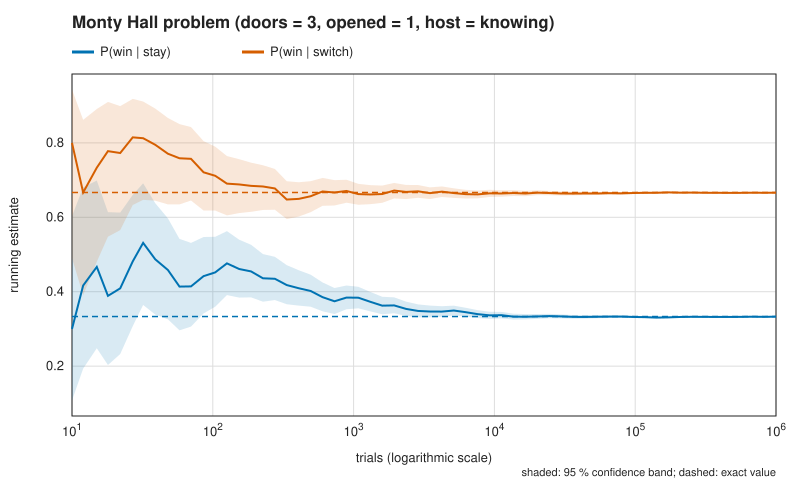
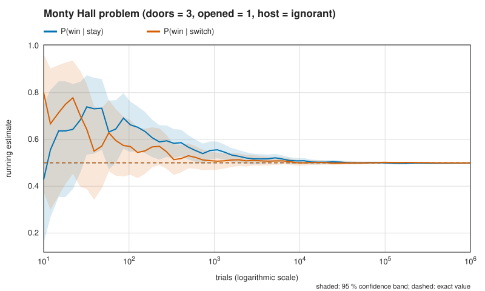
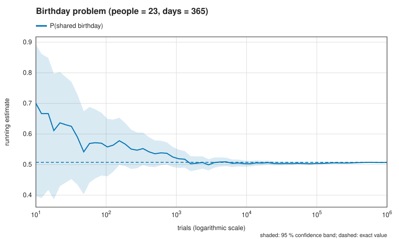
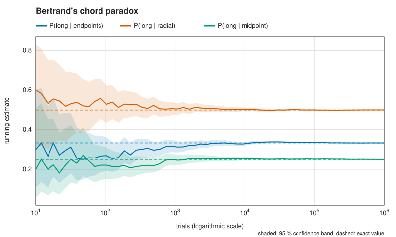
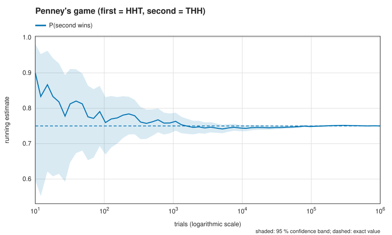
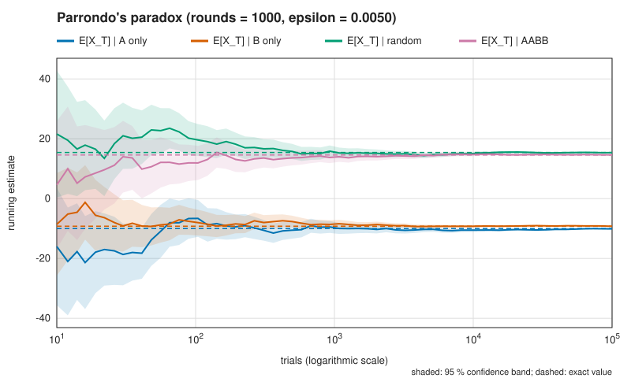

# Aporia

Aporia is a Monte-Carlo laboratory for six results where intuition fails: the
Monty Hall problem, the birthday problem, Bertrand's chord paradox, Penney's
game, Parrondo's paradox and Braess's paradox. Each experiment simulates the
*mechanism* of the problem (the game is actually played, the chord actually
drawn, the drivers actually reroute), compares the estimate with a value
derived analytically and computed by separate code, and reports the estimate
with a confidence interval. The simulator never contains the answer; it can
only agree with it.

## Quick start

```
cargo run --release -- all
cargo run --release -- monty-hall --doors 10 --opened 8 --host ignorant
cargo run --release -- penney --first HTH --svg penney.svg
cargo run --release -- --help
```

Common options: `--trials N`, `--seed S` (decimal or `0x…`),
`--confidence 90|95|99`, and, for every experiment except `braess`,
`--svg PATH` for a convergence plot. Exit status is 0 on success, 1 for a
domain or I/O error (one line on stderr), and 2 for a usage error.

## Sample output

An excerpt of `aporia all` (release build, default seed), copied from an
actual run; the full run takes about 2.3 seconds on a laptop.

```
Monty Hall problem (monty-hall)
===============================

  Intuition   Two doors remain, so it is 50/50.
  Parameters  doors = 3, opened = 1, host = knowing
  Run         1000000 trials per quantity, seed 71813183981889, 95 % intervals

  quantity            exact  estimate               95 % CI  accepted/attempted  inside
  P(win | stay)    0.333333  0.332947  [0.332024, 0.333871]     1000000/1000000  yes
  P(win | switch)  0.666667  0.665990  [0.665065, 0.666914]     1000000/1000000  yes

  Exact       Switching wins (n-1)/(n-k-1) = 2.000000 times as often as
              staying.
  Lesson      The information is in the host's knowledge, not in the revealed
              goat. A knowing host never opens the car, so the probability
              that the first pick was wrong is concentrated on the doors the
              host left closed.

[... five more experiments ...]

Summary
=======

  experiment  quantity                      exact   estimate                 95 % CI  inside
  monty-hall  P(win | stay)              0.333333   0.332947    [0.332024, 0.333871]  yes
  monty-hall  P(win | switch)            0.666667   0.665990    [0.665065, 0.666914]  yes
  birthday    P(shared birthday)         0.507297   0.506933    [0.505953, 0.507913]  yes
  bertrand    P(long | endpoints)        0.333333   0.333190    [0.332267, 0.334114]  yes
  bertrand    P(long | radial)           0.500000   0.500466    [0.499486, 0.501446]  yes
  bertrand    P(long | midpoint)         0.250000   0.250000    [0.249152, 0.250850]  yes
  penney      P(second wins)             0.750000   0.750029    [0.749179, 0.750877]  yes
  parrondo    E[X_T] | A only            -10.0000   -10.1125     [-10.3086, -9.9164]  yes
  parrondo    E[X_T] | B only             -9.2181    -9.2543      [-9.3891, -9.1195]  yes
  parrondo    E[X_T] | random             15.4211    15.3695      [15.1863, 15.5527]  yes
  parrondo    E[X_T] | AABB               14.5772    14.6215      [14.4383, 14.8046]  yes
  braess      mean minutes, no shortcut   65.0000    65.0000      [65.0000, 65.0000]  yes
  braess      mean minutes, shortcut      80.0000    80.0000      [80.0000, 80.0000]  yes
  braess      improving moves, shortcut         -  3073.7850  [3068.7774, 3078.7926]  -

  13 of 13 exact values lie inside their 95 % intervals.
  With 95 % intervals roughly one comparison in twenty misses by chance, so an
  occasional "no" is expected and is not a bug.
```

## The six results

| Experiment | Intuition says | Truth | What breaks |
|---|---|---|---|
| `monty-hall` | Two doors remain, so 50/50. | Switching wins with probability 2/3. | The host's choice depends on where the car is. |
| `birthday` | About 183 people for an even chance. | 23 people suffice. | Collisions count pairs, and pairs grow quadratically. |
| `bertrand` | A random chord has one probability of being long. | 1/3, 1/2 or 1/4. | "Random" is undefined until the sampling mechanism is fixed. |
| `penney` | Some pattern must be best. | Every pattern of length ≥ 3 can be beaten. | "Beats" is not transitive. |
| `parrondo` | Two losing games mix into a losing game. | The mixture wins. | Mixing changes how often B's bad coin is used. |
| `braess` | A free extra road cannot hurt. | Everybody's trip gets longer. | Equilibrium is not optimum. |

### Monty Hall

`n` doors, one car; the player picks, the host opens `k` goat doors, the
player stays or switches to a uniformly random other closed door. Staying
wins iff the first pick was right: `1/n`. With a knowing host the remaining
probability `(n−1)/n` lies on the `n−k−1` other closed doors, so switching
wins with `(n−1)/(n(n−k−1))`; for `n = 3, k = 1` that is 2/3. An ignorant
host opens `k` doors at random among the `n−1` others; the car stays hidden
with probability `1/n + (n−1)/n · (n−1−k)/(n−1) = (n−k)/n`, and given that
event all `n−k` closed doors are symmetric, so both strategies win with
`1/(n−k)`. Games in which the ignorant host reveals the car are rejected,
which is exactly conditioning on what the player saw.

### Birthday problem

With `d` equally likely days, all `n` birthdays differ with probability
`∏_{i<n} (1 − i/d)`; the answer is one minus that. It is evaluated as
`−expm1(Σ ln_1p(−i/d))` to keep relative precision, and is 1 for `n > d`.
The smallest `n` with probability at least 1/2 is computed by the same
recurrence: 23 for `d = 365`, against the naive guess `⌈d/2⌉ = 183`.

### Bertrand's paradox

A chord of the unit circle is long if it exceeds `√3`, the side of the
inscribed equilateral triangle; equivalently, if its midpoint lies within
distance 1/2 of the centre. Two uniform endpoints: fixing one, the other must
fall on the opposite third of the circle, 1/3. A uniform distance along a
uniform radius: `P(distance < 1/2) = 1/2`. A midpoint uniform in the disk:
the inner disk has a quarter of the area, 1/4. A test documents the classic
mistake of drawing the midpoint's *radius* uniformly: since the area element
is `r dr dθ`, this is a different model and gives 1/2.

### Penney's game

For patterns `x`, `y` of length `L`, Conway's leading number is
`c(x,y) = Σ_{k=1}^{L} 2^(k−1) [last k symbols of x = first k symbols of y]`.
The odds that B appears before A are `(c(A,A) − c(A,B)) : (c(B,B) − c(B,A))`.
For HHT against THH the leading numbers are 4, 1, 4, 3, giving odds 3:1 for
THH. The formula is checked against an exact solution of the absorbing Markov
chain for all 310 ordered pairs of patterns of length 1 to 4. With `--first`,
the best response is found by exhaustive search over all `2^L` patterns.

### Parrondo's paradox

Game A wins with `1/2 − ε`. Game B wins with `1/10 − ε` when the capital is a
multiple of 3 and with `3/4 − ε` otherwise. Since the win probability depends
only on the capital modulo 3, the exact `E[X_T]` follows from propagating the
distribution over the three residues for `T` rounds and adding
`Σ_r π_t(r)(2p_t(r) − 1)` per round. For a time-homogeneous policy the
stationary distribution of the 3-cycle walk is
`π_r ∝ 1 − p_{r+1} + p_{r+1}p_{r+2}`; under B alone the capital is
`≡ 0 (mod 3)` with probability 0.383612 instead of 1/3, which is enough to make
B lose (drift −0.008695 per round). Under the random mixture the share drops to
0.345070 and the drift becomes +0.015704.

### Braess's paradox

`N` drivers go from S to T. S→A and B→T take `flow/100` minutes, S→B and A→T
take 45, the shortcut A→B is free. Without the shortcut a driver gains by
switching iff its route carries at least two more drivers than the other, so
for even `N` the unique equilibrium is the even split: `N/200 + 45` minutes.
With the shortcut, a driver on S-A-T gains by moving to S-A-B-T iff B→T
carries at most 4498 other drivers, which always holds for `N ≤ 4498`; so
every driver ends up on S-A-B-T, at `N/50` minutes, and nobody leaves, because
S-A-T would cost `N/100 + 45 ≥ N/50`. For `N = 4000` this is 65 versus 80
minutes; for `N = 3000` both are 60; for `N = 2000` the shortcut helps
(55 versus 40).

The dynamics terminate because the game has Rosenthal's potential
`Φ = Σ_edges Σ_{j=1}^{flow} cost(j)`, which changes by exactly the mover's
change in cost; every improving move lowers it by at least one hundredth of
a minute. The terminal state is therefore a pure Nash equilibrium, which the
tests confirm by brute force over all unilateral deviations.

For comparison with the social optimum: with the shortcut, total travel time
is convex in the flows and minimised by routing 500 drivers via the shortcut
and 1750 on each of the other routes, a mean of 64.6875 minutes. The
equilibrium's 80 minutes is thus 1.237 times the optimum, within the bound of
4/3 that Roughgarden and Tardos proved for linear latencies (their bound is
stated for the continuous-flow model; this optimum happens to be integral).
The often-quoted ratio 80/65 compares two equilibria, not equilibrium and
optimum.

## Figures

Running estimates against the number of trials, on a logarithmic axis, with
the confidence band shaded and the exact value dashed. Regenerate them with
`scripts/generate-figures.sh` (default seed).








## Design decisions

- **Mechanism, not solution.** Simulators implement the physical process and
  only see what a participant would see; the Monty Hall player chooses among
  the doors that are visibly closed, never among "doors that are not the car".
  Exact values are computed in separate functions and enter only the
  comparison.
- **Reproducibility.** One master seed (default `0x41504F524941`, the ASCII
  bytes of "APORIA"). Each quantity draws from its own ChaCha8 stream whose
  key comes from the master seed and whose stream number is the FNV-1a 64 hash
  of `"<experiment-id>/<quantity-label>"`, so adding an experiment never
  changes existing output. Everything is single-threaded. The same binary with
  the same arguments produces byte-identical output. Across platforms only
  statistical equivalence is promised, because transcendental functions such
  as `sin`, `ln_1p` and `expm1` are not required to be correctly rounded.
- **Wilson intervals** for probabilities: unlike the Wald interval they keep
  close to nominal coverage near 0 and 1 and never have width zero for 0 or
  `n` successes. Real-valued quantities use `mean ± z·s/√n` from Welford's
  algorithm; this rests on the central limit theorem and is a large-sample
  approximation.
- **Rejection sampling as conditioning.** Rejected trials are counted and
  reported (`accepted/attempted`) but excluded from the estimate. Too few
  accepted samples (none for a proportion, fewer than two for a mean) is a
  typed error, never a `NaN`.
- **Integer costs in Braess.** Travel times are integers in hundredths of a
  minute, so "strictly improving" is an exact comparison and ties (for
  example a driver on the busier route when `N` is odd, who would pay exactly
  the same after switching) cannot be broken by rounding. Drivers
  on the same route are interchangeable, so the state is the vector of route
  counts; a uniformly random improving (driver, route) pair is drawn by
  weighting each improving route change with its number of drivers. The step
  cap is the bound on Rosenthal's potential, so reaching it would be a bug.
- **Degenerate intervals.** When all samples are equal (Braess), the interval
  has width zero and "inside" is decided with an absolute tolerance of 1e-9.
- **Usage versus domain errors.** clap rejects malformed input (exit 2). Values
  that parse but lie outside an experiment's domain, such as `--doors 2`, are
  rejected by the library constructors (exit 1). `--trials` overrides the
  default trial count everywhere, including in `all`.
- **Penney.** Patterns use the letters `H` and `T` only. Without `--first` the
  default HHT is used and the best-response line is omitted. Best-response
  ties go to the lexicographically first pattern.
- **Braess quantities.** The number of improving moves is measured in the
  network with the shortcut, where the dynamics have the most work to do. The
  closed forms are reported only where stated above (even `N` without the
  shortcut, `N ≤ 4498` with it); elsewhere only the simulation is shown.
  `--svg` is not offered because every trial lands on the same equilibrium.
- **Library and binary.** The command-line code lives in the binary
  (`src/cli.rs`), so the library API does not expose clap types.
- **Dependencies.** `rand` and `rand_chacha` (ChaCha8 offers independent,
  seekable streams per key; `rand` is used with default features off since no
  OS entropy is ever needed), `clap` for argument parsing, `thiserror` for the
  error type's `Display` and `Error` impls (a derive with no runtime cost that
  replaces about forty lines of boilerplate), and `proptest` for tests only.
  `cargo tree -d` reports no duplicate crates.
- **Minimum Rust version.** `rust-version = "1.96"`, the installed stable
  release on which every check was run. Edition 2024 needs at least 1.85, but
  no older toolchain was tested, so no lower bound is claimed.

## Testing

```
cargo test --all-targets && cargo test --doc
```

- **Independent oracles.** Every exact formula is pinned against numbers
  verified independently (for example 0.507297 for 23 birthdays, −9.2181 for
  game B). Conway's formula is checked against a Gaussian-elimination
  solution of the Markov chain for all 310 pattern pairs of length 1 to 4.
  Braess equilibria are checked by brute force over every unilateral
  deviation of every driver, with edge flows recomputed from explicit edge
  lists.
- **Simulation against exact values** at a fixed seed, with a `z = 4`
  interval. At a fixed seed the test is deterministic either way; but a
  harmless refactoring that changes the order of random draws produces a new
  sample path, and with `z = 4` such a change fails a correct simulation with
  probability about 6e-5 per comparison instead of 5 %.
- **Statistics.** Wilson intervals at known values, Welford against a
  two-pass computation on data offset by 1e9, and the empirical coverage of the
  Wilson interval (`p = 0.3`, `n = 200`, 20,000 repetitions, within
  [0.93, 0.97]).
- **Properties** (proptest): probabilities in [0, 1], the birthday probability
  is monotone in `n`, Wilson intervals contain the point estimate and lie in
  [0, 1], and patterns survive a parse/display round trip.
- **Negative test.** Uniform radius instead of uniform area in Bertrand's
  midpoint method gives 1/2, not 1/4.
- **Engine invariant.** The last checkpoint of `run_with_checkpoints` equals
  a plain run with the same seed.
- **Command line.** The real binary is run for determinism, seed sensitivity,
  exit codes, SVG output and error messages.

## Limitations

- Statistical intervals are approximate: the normal interval for means relies
  on the central limit theorem, and roughly 5 % of 95 % intervals miss.
- Penney's game is simulated flip by flip; a trial costs on the order of
  `2^L` flips, so long patterns (up to 16 symbols are accepted) are slow.
- Closed forms for Braess's paradox cover only the ranges given above.
- Figures plot the running estimate of a single seed; they show one sample
  path, not a distribution of paths.
- Output is reproducible bit for bit only for the same binary; other
  platforms or compiler versions may differ in the last digits.

## Further reading

- J. Bertrand, *Calcul des probabilités*, Gauthier-Villars, Paris, 1889.
- D. Braess, "Über ein Paradoxon aus der Verkehrsplanung",
  *Unternehmensforschung* 12 (1968), 258–268.
  English translation: D. Braess, A. Nagurney, T. Wakolbinger, "On a paradox
  of traffic planning", *Transportation Science* 39(4) (2005), 446–450.
- G. P. Harmer and D. Abbott, "Parrondo's paradox", *Statistical Science*
  14(2) (1999), 206–213.
- R. W. Rosenthal, "A class of games possessing pure-strategy Nash
  equilibria", *International Journal of Game Theory* 2 (1973), 65–67.
- T. Roughgarden and É. Tardos, "How bad is selfish routing?", *Journal of the
  ACM* 49(2) (2002), 236–259.
- E. B. Wilson, "Probable inference, the law of succession, and statistical
  inference", *Journal of the American Statistical Association* 22(158)
  (1927), 209–212.

## License

MIT; see [LICENSE](LICENSE).
